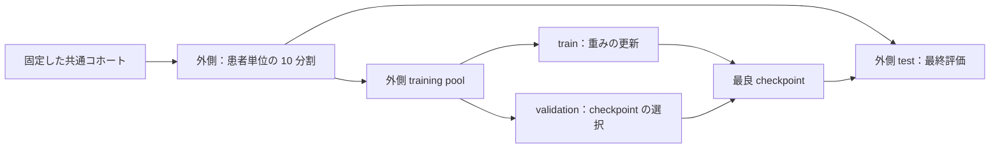

[English](README.md) | [繁體中文](README.zh-TW.md) | **[日本語](README.ja.md)**

# 単一ストリーム・マルチストリーム OCT 実験

データの確認、学習、モデル選択、交差検証、外部検証、推論を一貫して実行するための実験フレームワークです。単一ストリームと 2～8 ストリームで同じコードを使用し、設定の `data.streams` を変更するだけで切り替えられます。

**元のバージョンは `../old/` にすべて保存されています。** 本フレームワークは既存の実験コードを整理し、旧版の評価設計を修正したものです。旧版をそのまま移植したものではなく、旧版と同じ定義の評価値は生成しません。

## 1. プロジェクト構成

```text
multistream_project/
├── old/                         # 元のコード、モデル、画像、records、wandb、監査記録
├── new/
│   ├── main.py                  # 学習・検証およびローカル checkpoint による推論の入口
│   ├── configs/                 # 共通設定と単一・マルチストリームの設定例
│   ├── multistream/
│   │   ├── config.py            # 設定の継承、パスとパラメータの検証
│   │   ├── data.py              # データ走査、manifest、ストリーム間で同期した画像前処理
│   │   ├── splits.py            # 患者単位の固定分割、外側 test・内側 validation
│   │   ├── models.py            # 汎用の単一ストリーム・特徴融合モデルと厳密な checkpoint 読み込み
│   │   ├── metrics.py           # Accuracy、F1、クラス別 recall、AUROC、混同行列
│   │   ├── engine.py            # 学習、モデル選択、テスト、症例別予測の出力
│   │   ├── gradcam.py           # ResNet のストリーム別 Grad-CAM
│   │   └── cli.py               # 各モジュールを接続するコマンドライン処理
│   ├── tools/
│   │   ├── create_demo_data.py  # 処理の動作確認用に合成画像を生成
│   │   ├── run_experiments.py   # 共通の分割で 16 条件を比較
│   │   ├── infer_published.py   # Hugging Face の condition・fold を指定して推論
│   │   ├── export_model_collection.py # 全ストリーム条件・fold のモデルをエクスポート
│   │   └── upload_model_collection.py # モデルごとに検証してアップロード・再開
│   ├── tests/                   # データ分離、読み込み、指標、処理全体のテスト
│   ├── artifacts/              # prepare で manifest.json / splits.json を生成
│   └── runs/                   # 実験ごとに独立したディレクトリを使用し、既存の記録を保持
├── archive_manifest.json
└── README.md
```

### 旧バージョンと新バージョンの違い

| 項目 | 旧バージョン | 新バージョン |
|---|---|---|
| プログラムの入口 | ストリーム数ごとに train ファイルを複製 | 単一の入口と汎用モデル |
| 分割の単位 | 症例フォルダをランダムに fold に分割 | `patient_id` によるグループ分割 |
| 検証とテスト | 同じ fold で最良モデルを選択し、最高値を報告 | 内側 validation でモデルを選択し、外側 test で最終評価 |
| データ分割の保存 | 同一 JSON が上書きされる可能性あり | manifest / splits を固定し、フィンガープリントで照合 |
| 前処理 | 学習・検証と推論で crop パラメータが異なる | checkpoint に設定を保存し、検証・推論で同じ設定を使用 |
| 入力の順序 | dict と外部テンプレートに依存 | checkpoint に streams の順序を明示的に保存 |
| モデルの読み込み | 推論時に `strict=False` を使用 | strict モードで、欠落・余分なパラメータをいずれも拒否 |
| 結果 | Accuracy / loss、推論ではクラスラベル（hard label）のみ保存 | クラス別確率、各種指標、症例別 CSV を保存 |

## 2. 実行環境

**Python 3.11** を推奨します。Python 3.10 以上および PyTorch 2.6 以上が必要です。今回の整理では `new/.venv/` に独立した CPU テスト環境を構築し、既存の旧 PyTorch 環境は使用していません。

Windows では `new/` ディレクトリから次のコマンドを実行できます。

```powershell
.\.venv\Scripts\python.exe main.py --help
.\.venv\Scripts\python.exe -m pytest tests -q
```

別のコンピュータに移す場合は、`.venv/` をコピーせず、環境を作り直してください。

```bash
# ここで使用する python が Python 3.11 であることを確認してから環境を作成
python -m venv .venv
# Windows: .venv\Scripts\activate
# Linux/macOS: source .venv/bin/activate
python -m pip install -r requirements-dev.txt
```

本番の GPU 学習では、まず [PyTorch 公式インストールページ](https://pytorch.org/get-started/locally/)に従って CUDA に対応する torch / torchvision をインストールし、その後 requirements をインストールしてください。CPU テスト環境自体は CUDA に対応していません。`device: auto` は実行環境に応じて CPU または GPU を選択します。

`model.pretrained: true` を初めて使用すると ImageNet の重みがダウンロードされます。オフラインのテストには `pretrained: false` を使用してください。

## 3. 合成データで動作を確認

以下は `new/` で実行する一連の手順です。合成データはプログラムの動作確認専用であり、**眼科モデルの性能を示すものではありません**。

```powershell
.\.venv\Scripts\python.exe tools/create_demo_data.py --output smoke_output/dataset
.\.venv\Scripts\python.exe main.py prepare --config configs/smoke.yaml
.\.venv\Scripts\python.exe main.py train --config configs/smoke.yaml
.\.venv\Scripts\python.exe main.py train --config configs/smoke_fusion.yaml
.\.venv\Scripts\python.exe main.py validate --checkpoint smoke_output/single_run/fold_0/best_model.pth --manifest smoke_output/manifest.json --splits smoke_output/splits.json --subset test --output smoke_output/validation_demo
.\.venv\Scripts\python.exe main.py infer --checkpoint smoke_output/fusion_run/fold_0/best_model.pth --root smoke_output/dataset --output smoke_output/inference_demo --gradcam --max-cams 2
```

テストの出力先がすでに存在する場合、既存の内容を保持し、上書きを拒否します。今回の整理で実行済みのサンプル出力は `smoke_output/` に保存されています。再実行する際は新しいパスを使用するか、smoke 設定をコピーして root、manifest、splits、output_dir を変更してください。

## 4. 実データの形式と患者 ID

```text
dataset/
├── bad/
│   └── PATIENT001_EXAM001_OD/
│       ├── PATIENT001_EXAM001_OD_vertical.jpg
│       ├── PATIENT001_EXAM001_OD_horizontal.jpg
│       ├── PATIENT001_EXAM001_OD_color_full.jpg
│       ├── PATIENT001_EXAM001_OD_color_inner.jpg
│       ├── PATIENT001_EXAM001_OD_color_outer.jpg
│       ├── PATIENT001_EXAM001_OD_gray_full.jpg
│       ├── PATIENT001_EXAM001_OD_gray_inner.jpg
│       └── PATIENT001_EXAM001_OD_gray_outer.jpg
└── good/
    └── PATIENT002_EXAM001_OS/
        └── ...
```

デフォルトのクラス対応は `bad=0`、`good=1` です。この設定はモデルとともに保存され、推論時に class index を再推定しません。対応画像形式は jpg/jpeg/png/bmp/tif/tiff/webp です。

データの走査順は固定されています。同じ症例名に異なるラベルが付いている場合、画像候補が複数ある場合、同一の完全画像パスが重複して使用される場合はエラーになります。`require_all_streams: true` では、必要なストリームが欠けている場合もエラーになります。`false` では不完全な症例を除外し、`scan_report` に記録します。推論時には、モデルに必要なすべてのストリームが必須です。

**重要：データ走査時には、フォルダ名の最初の `_` より前の文字列を `patient_id` として扱います。** 例えば `PATIENT001_EXAM001_OD` の患者キーは `PATIENT001` です。この規則が実際の患者識別情報に一致することを事前に確認してください。プログラムはファイル名だけで患者の同一性を確認できません。同一患者の両眼および異なる検査には、同じ patient_id を使用する必要があります。

正式な患者索引に基づいて manifest を用意すれば、ファイル名の規則に依存せずにデータを指定できます。

```json
{
  "version": 1,
  "class_to_idx": {"bad": 0, "good": 1},
  "streams": ["gray_inner"],
  "samples": [
    {
      "sample_id": "EXAM001_OD",
      "patient_id": "VERIFIED_PATIENT001",
      "label": 0,
      "images": {"gray_inner": "../images/EXAM001_OD_gray_inner.jpg"}
    }
  ]
}
```

これは 1 症例の形式を示す例です。実際の fold 分割には、十分な患者数と各クラスの症例が必要です。JSON 内の相対画像パスは manifest の所在ディレクトリを基準に解決されます。手作業で作成した manifest では `fingerprint` を省略でき、その場合は読み込み時に再計算されます。既存の fingerprint が内容と一致しない場合は読み込みを拒否します。patient_id / label を編集した場合は、古い fingerprint を削除して別の manifest として保存し、prepare を再実行してください。

各症例の images は、manifest.streams と過不足なく一致する必要があります。8 種類の単一ストリームと融合モデルを公平に比較する場合、manifest には全 8 ストリームを含め、学習時に指定したサブセットのみを使用してください。

フィンガープリントの対象はメタデータ、label、patient_id、streams、正規化された画像パスであり、**画像のバイト列は含みません**。画像の内容は変更しないでください。現状では、同じパスで画像を上書きしてもフィンガープリントでは検出できません。

## 5. 設定とデータ準備

最初に `configs/base.yaml` の `data.root` を変更してください。設定例のパスは旧プロジェクトのデータソースを引き継いでいます。元のデータはこのワークスペースには含まれていないため、実在するデータの場所を指定する必要があります。

**YAML 内の相対パスはその設定ファイルの所在ディレクトリを、コマンドラインで上書きした相対パスはコマンド実行時のカレントディレクトリを基準に解決されます。** `extends: base.yaml` で共通設定を継承できます。継承したパスも、そのパスが定義されたファイルを基準に解決されます。

```bash
python main.py prepare --config configs/base.yaml
# または正式な患者 manifest から新しい共通データと分割を作成
python main.py prepare --config configs/base.yaml --from-manifest verified_manifest.json
```

prepare はデフォルトで、共通コホートに全 8 種類の画像がそろっていることを要求し、次のファイルを生成します。

- `artifacts/manifest.json`：症例、患者、label、各ストリームの画像パス、フィンガープリント。
- `artifacts/splits.json`：固定された train / validation / test の sample IDs とフィンガープリント。

外側の分割には 10 分割の `StratifiedGroupKFold` を使用し、同一患者の全症例を同じ外側 fold に割り当てます。各外側 training pool から、患者の約 20% を内側 validation として確保します。内側の分割では、固定 seed で生成した group holdout の候補から、目標のサイズとクラス比率に近いものを選択します。3 つの partition すべてに各クラスが含まれる必要があり、患者数が不足する場合はエラーになります。



すべてのモデルで同じ manifest / splits を使用してください。ストリームごとに prepare を再実行すると、モデル比較に用いるデータ条件が変わってしまいます。

## 6. 学習

```bash
python main.py train --config configs/single_gray_inner.yaml
python main.py train --config configs/fusion_2_color.yaml
python main.py train --config configs/fusion_3_color.yaml
python main.py train --config configs/fusion_4.yaml
python main.py train --config configs/fusion_6.yaml
python main.py train --config configs/fusion_8.yaml
```

最初は 1 fold のみ実行し、メモリ使用量と設定を確認してください。

```bash
python main.py train --config configs/fusion_8.yaml --folds 0
# 後から同じ設定と出力先を使用して、まだ作成していない fold を実行
python main.py train --config configs/fusion_8.yaml --folds 1 2 3 4 5 6 7 8 9
```

既存の fold は上書きできません。完了済みの fold を保持したまま、残りの fold を追加で実行できます。**現在、途中の epoch から学習を再開する機能はありません。** fold の実行が途中で失敗した場合は、その実行記録を保持し、新しい output_dir を使用して再実行してください。

### モデルと前処理

単一ストリームには timm の分類モデルを使用します。マルチストリームでは、各ストリームに独立した backbone を使用し、グローバルプーリング後の特徴量を連結して 2 層 MLP と分類器に入力します。これは特徴量レベルの融合であり、画素を直接連結する方式ではありません。

デフォルトは ResNet50、ImageNet 重みによる初期化、すべての backbone のファインチューニングです。`freeze_backbones: true` の場合は backbone の重みと BatchNorm の統計量を固定し、融合 MLP / classifier の学習は継続します。

前処理のデフォルト入力サイズは 448×448 です。学習時のランダム crop と水平反転には、各ストリームで同じ幾何学的パラメータを適用します。validation / test / infer では、RGB、Resize、CenterCrop、Normalize の共通処理を使用します。`image_size <= resize_size` が必要で、不正な組み合わせは学習開始前にエラーになります。水平反転の妥当性は、使用画像や左右眼を含む研究設計に応じて判断してください。

デフォルトは AdamW、lr 0.0007、50 epochs、cosine scheduler です。validation loss が最小のモデルを選択し、10 epochs 改善がなければ early stopping で終了します。`patience: 0` で early stopping を無効にできます。`selection_metric` は `accuracy`、`balanced_accuracy`、`macro_f1`、`auroc` に変更できます。いずれの指標も内側 validation のみで計算し、test をモデル選択に使用しません。

### 新バージョンの単一ストリーム重みで融合モデルを初期化

この手順は任意です。デフォルトでは各 backbone を ImageNet の重みから直接初期化するため、旧版の checkpoint は不要です。

```yaml
model:
  initialization:
    color_inner: ../runs/single_color_inner/fold_{fold}/best_model.pth
    color_outer: ../runs/single_color_outer/fold_{fold}/best_model.pth
```

先に共通の manifest / splits を使用して、対応する新バージョンの単一ストリーム学習を完了してください。読み込み時には stream、architecture、fold、manifest、split、3 つの partition の patient IDs、class mapping、前処理を照合し、不一致があれば拒否します。患者分割情報のない旧版の重みは、新バージョンの CV の初期化には使用できません。

合成データ用には `configs/smoke_warmstart.yaml` もあります。`configs/smoke.yaml` の実行後に使用すると、新バージョンの単一ストリーム重みで融合モデルを初期化する処理を確認できます。

## 7. 実験出力と評価指標

```text
runs/fusion_8/
├── config.json                  # 継承とパス解決を完了した全設定
├── experiment.json              # 設定、データ、split のフィンガープリント
├── splits.json                  # 今回使用した固定分割
├── fold_0/
│   ├── best_model.pth            # 重み、ストリーム順序、ラベル、前処理、患者分離情報
│   ├── epoch_metrics.csv         # epoch ごとの学習・内側検証結果
│   ├── validation_metrics.json   # モデル選択用の検証結果
│   ├── validation_predictions.csv
│   ├── test_metrics.json         # モデル選択に使用していない外側 test の結果
│   ├── test_predictions.csv      # 正解、予測、クラス別確率
│   └── summary.json
├── fold_1/ ...
├── summary.json                 # 完了した fold、各 fold の結果、OOF 統合指標
├── summary.csv                  # fold ごとの比較表
└── out_of_fold_predictions.csv   # 各症例の外側 test での予測のみを収集
```

validation の最高値ではなく、**test / out-of-fold** の指標を優先して報告してください。一部の fold しか完了していない場合、OOF はその範囲のみを対象とし、完全な 10 分割の結果として扱うことはできません。同一患者に複数回の検査がある場合も、指標は症例単位です。患者単位の集約方法と、患者をサンプリング単位とする信頼区間は別途定義する必要があります。

出力には Accuracy、balanced Accuracy、macro F1、クラス別 precision/recall/F1、one-vs-rest AUROC、macro AUROC、混同行列が含まれます。混同行列は行が正解、列が予測で、クラスの順序も明示的に保存します。クラスが不足する場合、AUROC は 0 ではなく `null` になります。`summary.json` には各 fold の test 指標の平均と標本標準偏差（sample SD）も含まれます。各 fold の AUROC の平均と、異なる fold のモデルによる OOF 確率をまとめて計算した AUROC は別の統計量なので、区別して記載してください。

`bad=0 / good=1` の場合、「bad recall」は bad を検出する能力、「good recall」は good を検出する能力を表します。sensitivity を記載する際は、陽性とするクラスを明示してください。balanced Accuracy は正解サンプルが存在するクラスの recall の平均、macro F1 は設定された全クラスの F1 の平均です。

本バージョンはローカルの JSON / CSV に記録を保存するため、W&B アカウントは不要です。既存の W&B データは `../old/wandb/` にすべて保存されています。

## 8. 検証と推論

### 特定 fold の固定外側 test を再評価

```bash
python main.py validate --checkpoint runs/fusion_8/fold_0/best_model.pth --manifest artifacts/manifest.json --splits artifacts/splits.json --subset test --output runs/recheck_fold_0
```

モデル選択に用いた validation を確認する場合は `--subset validation` に変更してください。出力にはモデル選択用の検証であることが明示され、独立した test としては扱えません。

### ラベル付きの新規コホート

```bash
python main.py validate --checkpoint runs/fusion_8/fold_0/best_model.pth --root /path/to/new_labeled_dataset --output runs/external_fold_0
```

デフォルトでは、新規コホートの patient IDs を checkpoint に保存された training / validation の patient IDs と照合し、重複があれば停止します。この確認には信頼できる patient_id が必要であり、元の患者索引や画像の出所の確認に代わるものではありません。探索的な解析に限り `--allow-patient-overlap` を明示的に指定できますが、結果には独立性を確認できないことが記録されます。

### ラベルなし画像の推論

```text
unlabeled_dataset/
├── PATIENT901_EXAM001_OD/
│   └── ...モデルに必要な画像...
└── PATIENT902_EXAM001_OS/
    └── ...
```

```bash
python main.py infer --checkpoint runs/fusion_8/fold_0/best_model.pth --root /path/to/unlabeled_dataset --output runs/inference_fold_0
```

`infer` はラベルの有無にかかわらず予測を実行し、患者の重複によって処理を停止しません。予測の生成を目的とするため、この実行だけを根拠に独立した検証と主張することはできません。ラベルがある場合は記述的な指標も出力し、`evaluation_scope.json` に用途を明示します。ラベルがない場合、正解率は生成しません。

推論に必要なのは checkpoint と入力データだけです。architecture、streams の順序、class mapping、crop、normalization はすべて checkpoint から読み込みます。出力は `predictions.csv`、`metrics.json`、`evaluation_scope.json` です。異なる fold には異なる出力ディレクトリを使用してください。例：

```powershell
0..9 | ForEach-Object {
    .\.venv\Scripts\python.exe main.py infer --checkpoint "runs/fusion_8/fold_$_/best_model.pth" --root "D:/my_cohort" --output "runs/inference_fold_$_"
}
```

これは同じコホートに対する 10 個のモデルの予測であり、独立した 10 個の test cohort ではありません。本バージョンでは、それらを暗黙に 430 症例にまとめたり、すべての fold のモデルを内部症例に適用した結果を OOF として扱ったりしません。

### Grad-CAM

```bash
python main.py infer --checkpoint runs/fusion_8/fold_0/best_model.pth --root /path/to/data --output runs/inference_with_cam --gradcam --max-cams 8
```

現在は `layer4` を持つ ResNet に対応しています。モデルの予測クラスを対象に、各ストリームの最終 block で Grad-CAM を個別に計算し、**モデルが実際に使用した center crop** に重ねて表示します。`gradcam/index.json` に画像とストリームの対応を記録します。これはモデルが着目する領域の可視化であり、正解アノテーションやモデルの妥当性・信頼性を証明するものではありません。

## 9. 旧モデルの保持と変換

元のモデルは `../old/records/` に保存されています。新バージョンはストリームの順序、ラベル、crop 設定を自動推定しません。元の実験と一致する設定を指定してから、厳密な検証のもとで変換してください。

```bash
python main.py convert-legacy --checkpoint ../old/records/image-classification-7/resnet50_runresnet50_run_gray_inner@0_fold/best_model.pth --config configs/single_gray_inner.yaml --output runs/legacy_gray_inner.pth
python main.py infer --checkpoint runs/legacy_gray_inner.pth --root /path/to/data --output runs/legacy_predictions
```

対応するのは、元の timm 単一ストリーム state dict と、旧版の b1…bN / merger / fc による特徴融合構造のみです。architecture と hidden_dim が一致する必要があります。読み込みには `weights_only=True` を使用し、任意の pickle を読み込む方式へのフォールバックは行いません。変換後は `legacy_no_split_metadata: true` として記録され、推論には使用できますが、新しい患者単位の CV の初期化重みには使用できません。過去のデータ分割の来歴情報がない場合、外部検証が患者単位で独立しているかどうかは確認できません。

上記の例は、設定を明示したうえで変換する手順を示したものです。当時の crop / ストリーム順序が未確認の場合は、過去の設定を復元してから性能を比較してください。

## 10. 共通の分割で 16 条件を比較

```bash
python tools/run_experiments.py --list
# まず最良の単一ストリーム基準モデルと 8 ストリームを比較
python tools/run_experiments.py --config configs/base.yaml --conditions single_gray_inner fusion_8
# または 1 fold を指定して試行
python tools/run_experiments.py --config configs/base.yaml --conditions single_gray_inner fusion_8 --folds 0 --output runs/pilot
# --conditions を指定しない場合は全 16 条件を順に実行
```

このツールは共通の manifest / splits を読み込み、条件ごとに streams を変更して、完全な実験記録と `comparison.csv` を個別に保存します。比較表には各条件で完了した fold の OOF test 指標が含まれます。completed_folds / planned_folds が条件間で一致していることを必ず確認してください。データ走査と prepare は一度だけ実行すれば十分です。

## 11. 検証済みの範囲と参考資料

`python -m pytest tests -q` でテストを再実行できます。テストには、患者分離、fold の網羅性、ラベルの矛盾、フィンガープリントの不一致、同期 crop、各ストリーム数の forward、strict checkpoint、warm start、手計算との指標照合、validation のみを用いるモデル選択、小規模な CPU 学習・検証・推論が含まれます。

学習フレームワークの初回提供時のテスト結果は **58 passed、14 subtests passed** でした。加えて、単一・2 ストリームの 2 fold 実行、固定 test の再評価、ラベル付き・ラベルなし推論、Grad-CAM、新バージョンの単一ストリーム重みによる融合モデルの初期化、16 条件比較ツールのうち 2 条件の試行、既存の単一ストリーム重みの厳密な検証による変換を実際に実行しました。環境のバージョンは `requirements-tested.txt`、検証記録は `verification.json` を参照してください。このバージョン一覧は今回の CPU テスト環境の記録であり、GPU 環境のインストール手順ではありません。

処理全体のテストには合成データを使用しているため、実画像での性能検証に代わるものではありません。元の実画像と過去の推論テンプレートの一部は現在のワークスペースに含まれておらず、実コホートでの正式な実験はまだ再実行していません。

- [PyTorch checkpoint の読み込み](https://docs.pytorch.org/docs/stable/generated/torch.load.html)
- [scikit-learn StratifiedGroupKFold](https://scikit-learn.org/stable/modules/generated/sklearn.model_selection.StratifiedGroupKFold.html)
- [timm feature extraction](https://huggingface.co/docs/timm/en/feature_extraction)
- 元の内部実験の監査記録 (local archive; not uploaded)

## 12. GitHub と Hugging Face への公開

リポジトリのトップページ、本利用ガイド、モデルコレクション、各モデルの既定の README は英語で表示します。各ページ上部のリンクから繁体字中国語と日本語に切り替えられます。公開ツールは、コレクションと各モデルの README を 3 言語で再生成します。

Windows で [publish_erm_ai.bat](publish_erm_ai.bat) をダブルクリックすると、`ntuhophai/ERM-AI` をローカルでログインしている GitHub アカウントに fork し、新バージョンのコードとドキュメントを commit して、手動で PR を作成するための比較ページを開きます。前回の公開用ブランチに他の変更がなく、PR が close / merge されていない場合は、そのブランチを更新し、既存の PR にも変更が反映されます。

モデルの公開処理では、**16 ストリーム条件 × 10 folds = 160 モデルと、7 個の過去の重み、合計 167 個**を自動的に処理し、Hugging Face の `ntuhophai/ERM-AI` に対する同一 PR に追加して、管理者による merge を待ちます。1 個の checkpoint だけを選ぶのではなく、条件・fold ごとに独立したディレクトリ、重みのみのファイル、config、説明を用意します。元のモデルは約 43.4 GB あり、初回のエクスポートには追加の空き容量が必要です。中断後は、キャッシュとリモートの内容を照合して処理を再開できます。

初回は公式のログイン手順と、ローカルの legacy profile の確認が必要です。パスワードや Token はスクリプトに保存しません。旧モデルは引き続き `old/` に保持されます。過去の設定が不完全な 7 モデルはテンソルを保存し、自動推論できないことを明示します。

- [PUBLISHING.md](PUBLISHING.md)：BAT の操作、PR、権限、公開範囲、転送の再開。
- [MODEL_CATALOG.md](MODEL_CATALOG.md)：全モデル、固定されたストリーム順序、アーキテクチャ、ラベル、前処理上の制限。
- [INFERENCE.md](INFERENCE.md)：指定モデル・fold のダウンロード、全 10 fold の推論、ensemble、確率 CSV、バージョンの固定。

Hugging Face のモデルによる推論例（`new/` から実行）：

```powershell
.\.venv\Scripts\python.exe tools/infer_published.py --repo ntuhophai/ERM-AI --condition single_gray_inner --fold 0 --root "D:/my_cases" --output "predictions/gray_inner_fold0"
.\.venv\Scripts\python.exe tools/infer_published.py --repo ntuhophai/ERM-AI --condition fusion_8 --all-folds --root "D:/my_cases" --output "predictions/fusion8_all"
```

完全なモデルコレクションは既定の `main` リビジョンで公開済みのため、上記のコマンドはそのまま使用できます。バージョンを固定する場合は `--revision <commit-sha>` を追加してください（[INFERENCE.md](INFERENCE.md) を参照）。管理者がまだ merge されていない新しい Hub PR を確認する場合は、`--revision refs/pr/<number>` を使用できます。ダウンロードされるのは指定したモデルのみで、画像はローカルに残ります。これらの legacy 重みには患者分割のメタデータがないため、その推論結果を新バージョンの患者単位 CV の成績として報告することはできません。

2026-10-12 の更新後の全テスト結果：**186 passed、33 subtests passed**。公開対象の 160 個の fold モデルについて、重みのキー、形状、データ型が宣言されたアーキテクチャと一致することも確認済みです。完全なモデルパッケージはローカルにエクスポート済みで、アップロード前のチェックを通過しています。実際のリモート転送は BAT が実行します。
