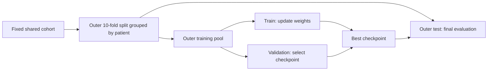

[English](README.md) | [繁體中文](README.zh-TW.md) | [日本語](README.ja.md)

> Public source snapshot: legacy files, datasets, private results and local environments are not included in this repository.

# Single-Stream and Multi-Stream OCT Experiments

A unified workflow for data validation, training, model selection, cross-validation, external validation, and inference. Single-stream and 2–8-stream experiments share the same implementation; select the inputs through `data.streams`.

**The original implementation is preserved in full in `../old/` in the local project archive.** This reorganized framework corrects the evaluation design used in the original implementation. Its evaluation scores therefore have a different definition and should not be treated as directly equivalent to the historical scores. References to `../old/` and `archive_manifest.json` describe the local archive; these files are not included in the published code or model repositories.

## 1. Project Structure

```text
multistream_project/
├── old/                         # Original code, models, images, records, W&B logs, and audits
├── new/
│   ├── main.py                  # Entry point for training, validation, and local checkpoint inference
│   ├── configs/                 # Shared configuration and single-/multi-stream examples
│   ├── multistream/
│   │   ├── config.py            # Configuration inheritance, paths, and parameter validation
│   │   ├── data.py              # Data scanning, manifests, and synchronized preprocessing
│   │   ├── splits.py            # Fixed patient groups; outer test and inner validation sets
│   │   ├── models.py            # Generic single-stream and feature-fusion models; strict loading
│   │   ├── metrics.py           # Accuracy, F1, per-class recall, AUROC, and confusion matrices
│   │   ├── engine.py            # Training, model selection, testing, and per-sample predictions
│   │   ├── gradcam.py           # Per-stream Grad-CAM for ResNet models
│   │   └── cli.py               # Command-line workflows connecting these modules
│   ├── tools/
│   │   ├── create_demo_data.py  # Generate synthetic images to check the workflow
│   │   ├── run_experiments.py   # Compare 16 conditions using identical splits
│   │   ├── infer_published.py   # Run inference for a Hugging Face condition/fold
│   │   ├── export_model_collection.py # Export all stream/fold models
│   │   └── upload_model_collection.py # Verify and upload/resume each model
│   ├── tests/                   # Data separation, loading, metrics, and end-to-end tests
│   ├── artifacts/               # manifest.json / splits.json generated by prepare
│   └── runs/                    # Separate experiment directories; existing records are preserved
├── archive_manifest.json
└── README.md
```

### Changes from the Original Implementation

| Aspect | Original implementation | Reorganized framework |
|---|---|---|
| Entry points | Separate training files duplicated for each stream count | One entry point and generic models |
| Split unit | Case folders randomly assigned to folds | Grouped by `patient_id` |
| Validation and testing | The same fold used for model selection and reporting the peak score | Inner validation for model selection; outer test for final evaluation |
| Split preservation | The same JSON file could be overwritten | Fixed manifest/splits verified with fingerprints |
| Preprocessing | Different crop settings for training/validation and inference | Settings stored in the checkpoint and shared by validation and inference |
| Input order | Determined by dictionaries and external templates | Stream order explicitly stored in the checkpoint |
| Model loading | Inference with `strict=False` | Strict loading; missing or unexpected parameters are rejected |
| Outputs | Accuracy/loss; inference saved hard labels only | Per-class probabilities, class-specific metrics, and per-sample CSV files |

## 2. Environment

**Python 3.11** is recommended. The code requires Python 3.10 or later and PyTorch 2.6 or later. A separate CPU test environment was created at `new/.venv/` when the framework was reorganized, independently of the original PyTorch environment.

On Windows, run the following from `new/` if that local environment is available:

```powershell
.\.venv\Scripts\python.exe main.py --help
.\.venv\Scripts\python.exe -m pytest tests -q
```

On another computer, recreate the environment rather than copying `.venv/`:

```bash
# Confirm that python refers to Python 3.11 before creating the environment.
python -m venv .venv
# Windows: .venv\Scripts\activate
# Linux/macOS: source .venv/bin/activate
python -m pip install -r requirements-dev.txt
```

For GPU training, first install CUDA-compatible versions of torch and torchvision using the [official PyTorch installation guide](https://pytorch.org/get-started/locally/), then install the requirements. The CPU test environment does not support CUDA. `device: auto` selects a CPU or GPU according to the active environment.

The first use of `model.pretrained: true` downloads ImageNet weights. Use `pretrained: false` for offline testing.

## 3. Run a Synthetic Data Example

Run the following end-to-end example from `new/`. Synthetic data checks whether the workflow runs; **it does not demonstrate ophthalmic model performance**.

```powershell
.\.venv\Scripts\python.exe tools/create_demo_data.py --output smoke_output/dataset
.\.venv\Scripts\python.exe main.py prepare --config configs/smoke.yaml
.\.venv\Scripts\python.exe main.py train --config configs/smoke.yaml
.\.venv\Scripts\python.exe main.py train --config configs/smoke_fusion.yaml
.\.venv\Scripts\python.exe main.py validate --checkpoint smoke_output/single_run/fold_0/best_model.pth --manifest smoke_output/manifest.json --splits smoke_output/splits.json --subset test --output smoke_output/validation_demo
.\.venv\Scripts\python.exe main.py infer --checkpoint smoke_output/fusion_run/fold_0/best_model.pth --root smoke_output/dataset --output smoke_output/inference_demo --gradcam --max-cams 2
```

The program preserves existing outputs and refuses to overwrite them. Outputs from the examples run during the original framework verification are stored locally in `smoke_output/`. To rerun them, use new paths or copy the smoke configuration and update its root, manifest, splits, and output_dir.

## 4. Real Data Format and Patient IDs

```text
dataset/
├── bad/
│   └── PATIENT001_EXAM001_OD/
│       ├── PATIENT001_EXAM001_OD_vertical.jpg
│       ├── PATIENT001_EXAM001_OD_horizontal.jpg
│       ├── PATIENT001_EXAM001_OD_color_full.jpg
│       ├── PATIENT001_EXAM001_OD_color_inner.jpg
│       ├── PATIENT001_EXAM001_OD_color_outer.jpg
│       ├── PATIENT001_EXAM001_OD_gray_full.jpg
│       ├── PATIENT001_EXAM001_OD_gray_inner.jpg
│       └── PATIENT001_EXAM001_OD_gray_outer.jpg
└── good/
    └── PATIENT002_EXAM001_OS/
        └── ...
```

The default class mapping is `bad=0`, `good=1`. It is saved with the model rather than inferred again during prediction. Supported image formats are jpg/jpeg/png/bmp/tif/tiff/webp.

The scanner uses deterministic ordering. It rejects case names appearing under conflicting labels, multiple candidate images for a stream, and reuse of the same full image path. With `require_all_streams: true`, a missing required stream also raises an error. With `false`, incomplete cases are skipped and recorded in `scan_report`. Inference always requires every stream used by the model.

**The scanner derives `patient_id` from the part of the folder name before the first `_`.** For example, `PATIENT001_EXAM001_OD` yields `PATIENT001`. Verify that this convention matches the actual patient identities: filenames alone cannot establish identity. Both eyes and all examinations from the same patient must use the same patient_id.

You can supply a manifest based on a verified patient index instead of relying on the filename convention:

```json
{
  "version": 1,
  "class_to_idx": {"bad": 0, "good": 1},
  "streams": ["gray_inner"],
  "samples": [
    {
      "sample_id": "EXAM001_OD",
      "patient_id": "VERIFIED_PATIENT001",
      "label": 0,
      "images": {"gray_inner": "../images/EXAM001_OD_gray_inner.jpg"}
    }
  ]
}
```

This single-case example illustrates the format only; actual fold construction requires enough patients in each class. Relative image paths in the JSON are resolved from the manifest directory. A manually created manifest may omit `fingerprint`, which is recalculated on loading. An existing fingerprint that does not match the contents is rejected. After editing patient_id or label, save a new manifest, remove the old fingerprint, and run prepare again.

Each sample's images must contain exactly the streams listed in manifest.streams. For a fair comparison of all eight single-stream models and the fusion models, include all eight streams in the manifest; training uses only the configured subset.

The fingerprint covers metadata, label, patient_id, streams, and normalized image paths, **but not image bytes**. Keep the image contents unchanged: overwriting an image at the same path is currently undetectable by the fingerprint.

## 5. Configure and Prepare the Data

First update `data.root` in `configs/base.yaml`. The example path refers to the original project's data source. The original images are not included in this workspace, so you must provide an existing data location.

**Relative paths in YAML are resolved from the directory containing that configuration file. Relative paths supplied as command-line overrides are resolved from the current working directory.** Use `extends: base.yaml` to inherit shared settings. Inherited paths remain relative to the file in which they were defined.

```bash
python main.py prepare --config configs/base.yaml
# Or create shared data and splits from a verified patient manifest.
python main.py prepare --config configs/base.yaml --from-manifest verified_manifest.json
```

By default, prepare requires all eight image types for the shared cohort and generates:

- `artifacts/manifest.json`: cases, patients, labels, per-stream paths, and a fingerprint.
- `artifacts/splits.json`: fixed train/validation/test sample IDs and fingerprints.

The outer split uses 10-fold `StratifiedGroupKFold`, keeping all cases from a patient in the same outer fold. Approximately 20% of the patients in each outer training pool are then reserved for inner validation. The inner split is selected from candidate group holdouts generated with a fixed seed, targeting the desired size and class proportions. Every class must be represented in all three partitions; insufficient patient numbers raise an error.



Use the same manifest/splits for every model. Preparing separate data for each stream would change the data conditions underlying the comparison.

## 6. Training

```bash
python main.py train --config configs/single_gray_inner.yaml
python main.py train --config configs/fusion_2_color.yaml
python main.py train --config configs/fusion_3_color.yaml
python main.py train --config configs/fusion_4.yaml
python main.py train --config configs/fusion_6.yaml
python main.py train --config configs/fusion_8.yaml
```

Start with one fold to check memory requirements and configuration:

```bash
python main.py train --config configs/fusion_8.yaml --folds 0
# Add the remaining folds later using the same configuration and output directory.
python main.py train --config configs/fusion_8.yaml --folds 1 2 3 4 5 6 7 8 9
```

Existing fold directories cannot be overwritten. Once some folds are complete, you can run the remaining folds. **Resuming a partially trained fold from an intermediate epoch is not currently supported.** If a fold fails, preserve its records and rerun it with a new output_dir.

### Models and Preprocessing

A single-stream model is a timm image classifier. A multi-stream model uses an independent backbone for each stream, concatenates their globally pooled features, and passes them through a two-layer MLP and a classifier. Fusion therefore occurs at the feature level.

The defaults are ResNet50, ImageNet initialization, and fine-tuning of all backbones. With `freeze_backbones: true`, backbone weights and BatchNorm statistics remain fixed while the fusion MLP/classifier is trained.

The default input size is 448×448. Random cropping and horizontal flipping use the same geometric parameters across streams during training. Validation, testing, and inference share RGB conversion, Resize, CenterCrop, and Normalize. `image_size <= resize_size` is required; invalid combinations are rejected before training. Decide whether horizontal flipping is appropriate for your image characteristics and study design, including eye laterality.

The default training setup uses AdamW, a learning rate of 0.0007, 50 epochs, a cosine scheduler, checkpoint selection by minimum validation loss, and early stopping after 10 epochs without improvement. `patience: 0` disables early stopping. Alternatives for `selection_metric` are `accuracy`, `balanced_accuracy`, `macro_f1`, and `auroc`. Model selection uses inner validation only; the test set is never used to select a checkpoint.

### Initialize Fusion Models from New Single-Stream Checkpoints

This step is optional. By default, each backbone is initialized from ImageNet without depending on legacy checkpoints.

```yaml
model:
  initialization:
    color_inner: ../runs/single_color_inner/fold_{fold}/best_model.pth
    color_outer: ../runs/single_color_outer/fold_{fold}/best_model.pth
```

First train the corresponding single-stream models with the new framework using the shared manifest/splits. Loading verifies the stream, architecture, fold, manifest, split, patient IDs in all three partitions, class mapping, and preprocessing. Any mismatch is rejected. Legacy weights without patient split information cannot initialize the new cross-validation experiments.

For synthetic data, run `configs/smoke_warmstart.yaml` after `configs/smoke.yaml` to check initialization of a fusion model from a new single-stream checkpoint.

## 7. Experiment Outputs and Metrics

```text
runs/fusion_8/
├── config.json                  # Fully resolved configuration
├── experiment.json              # Configuration, data, and split fingerprints
├── splits.json                  # Fixed splits used in this experiment
├── fold_0/
│   ├── best_model.pth            # Weights, stream order, labels, preprocessing, patient separation
│   ├── epoch_metrics.csv         # Training and inner-validation results for each epoch
│   ├── validation_metrics.json   # Validation results used for model selection
│   ├── validation_predictions.csv
│   ├── test_metrics.json         # Outer-test results, independent of model selection
│   ├── test_predictions.csv      # Ground truth, predictions, and per-class probabilities
│   └── summary.json
├── fold_1/ ...
├── summary.json                 # Completed folds, fold results, and pooled OOF metrics
├── summary.csv                  # Per-fold comparison table
└── out_of_fold_predictions.csv   # Each sample's prediction from its outer test fold only
```

Report **test/out-of-fold (OOF)** metrics in preference to peak validation scores. When only some folds are complete, OOF results cover only those folds and must not be presented as complete 10-fold results. Metrics remain case-level when patients have multiple examinations. Patient-level aggregation and confidence intervals based on patient resampling require separate definitions.

Outputs include accuracy, balanced accuracy, macro F1, per-class precision/recall/F1, one-vs-rest AUROC, macro AUROC, and a confusion matrix. Confusion-matrix rows represent ground-truth classes and columns represent predicted classes; class order is explicitly saved. AUROC is `null`, rather than 0, when the required classes are absent. `summary.json` also reports the mean and sample standard deviation of per-fold test metrics. Mean per-fold AUROC and AUROC computed from pooled OOF probabilities across fold models are different statistics and should be labeled separately.

With `bad=0 / good=1`, bad-class recall measures the ability to identify bad cases, and good-class recall measures the ability to identify good cases. Specify the positive class when reporting sensitivity. Balanced accuracy averages recall over classes represented in the ground truth; macro F1 averages F1 over all configured classes.

This framework records results in local JSON/CSV files and does not require a W&B account. The original W&B records are preserved in the local archive at `../old/wandb/`.

## 8. Validation and Inference

### Recompute a Fold's Fixed Outer-Test Results

```bash
python main.py validate --checkpoint runs/fusion_8/fold_0/best_model.pth --manifest artifacts/manifest.json --splits artifacts/splits.json --subset test --output runs/recheck_fold_0
```

Use `--subset validation` to inspect the validation set used for model selection. The outputs identify it as model-selection validation; it is not an independent test set.

### Validate on a New Labeled Cohort

```bash
python main.py validate --checkpoint runs/fusion_8/fold_0/best_model.pth --root /path/to/new_labeled_dataset --output runs/external_fold_0
```

By default, the new cohort is checked against the checkpoint's training/validation patient IDs, and validation stops if any overlap is found. This check depends on reliable patient_id values and does not replace verification against the original patient index and image provenance. For exploratory work, explicitly add `--allow-patient-overlap`; the results will state that independence cannot be established.

### Inference on Unlabeled Images

```text
unlabeled_dataset/
├── PATIENT901_EXAM001_OD/
│   └── ...images required by the model...
└── PATIENT902_EXAM001_OS/
    └── ...
```

```bash
python main.py infer --checkpoint runs/fusion_8/fold_0/best_model.pth --root /path/to/unlabeled_dataset --output runs/inference_fold_0
```

`infer` accepts labeled or unlabeled data and does not block predictions because of patient overlap. Generating these predictions does not establish independent validation. When labels are available, descriptive metrics are also produced, with the evaluation purpose recorded in `evaluation_scope.json`. Accuracy is not calculated without labels.

Inference requires only the checkpoint and a data source. Architecture, stream order, class mapping, cropping, and normalization are read from the checkpoint. Outputs are `predictions.csv`, `metrics.json`, and `evaluation_scope.json`. Use a separate output directory for each fold, for example:

```powershell
0..9 | ForEach-Object {
    .\.venv\Scripts\python.exe main.py infer --checkpoint "runs/fusion_8/fold_$_/best_model.pth" --root "D:/my_cohort" --output "runs/inference_fold_$_"
}
```

These are predictions from ten models on the same cohort, not ten independent test cohorts. The framework does not pool repeated predictions and present them as 430 distinct cases, or treat predictions from every fold model on the internal cases as OOF predictions.

### Grad-CAM

```bash
python main.py infer --checkpoint runs/fusion_8/fold_0/best_model.pth --root /path/to/data --output runs/inference_with_cam --gradcam --max-cams 8
```

Grad-CAM currently supports ResNet architectures with `layer4`. It is computed separately for the final block of each stream, targeting the model's predicted class, and overlaid on the **actual center crop supplied to the model**. `gradcam/index.json` records the image-to-stream mapping. These visualizations show model attention; they are neither ground-truth annotations nor evidence of reliability.

## 9. Preserve and Convert Legacy Models

The original models remain in the local archive at `../old/records/`. The new framework does not infer their stream order, labels, or crop settings. Supply settings matching the original experiment before performing strict conversion:

```bash
python main.py convert-legacy --checkpoint ../old/records/image-classification-7/resnet50_runresnet50_run_gray_inner@0_fold/best_model.pth --config configs/single_gray_inner.yaml --output runs/legacy_gray_inner.pth
python main.py infer --checkpoint runs/legacy_gray_inner.pth --root /path/to/data --output runs/legacy_predictions
```

Conversion supports original timm single-stream state dictionaries and the legacy b1…bN/merger/fc feature-fusion structure only. The architecture and hidden_dim must match. Loading uses `weights_only=True`, with no fallback to unrestricted pickle loading. Converted checkpoints are marked `legacy_no_split_metadata: true`. They can be used for prediction but cannot initialize the new patient-grouped cross-validation experiments. Without historical split provenance, patient independence in external validation cannot be confirmed.

The example above performs conversion under explicit settings. If the historical crop settings or stream order remain unresolved, recover them before comparing model performance.

## 10. Compare 16 Conditions Using Shared Splits

```bash
python tools/run_experiments.py --list
# Start by comparing the single-stream baseline with the eight-stream model.
python tools/run_experiments.py --config configs/base.yaml --conditions single_gray_inner fusion_8
# Or run a one-fold pilot.
python tools/run_experiments.py --config configs/base.yaml --conditions single_gray_inner fusion_8 --folds 0 --output runs/pilot
# Omitting --conditions runs all 16 conditions sequentially.
```

The tool reads the same manifest/splits, changes the streams for each condition, and saves each complete experiment plus `comparison.csv`. The comparison contains OOF test metrics for the completed folds of each condition. Check that completed_folds/planned_folds are consistent across conditions. Scanning and prepare are required only once.

## 11. Verification Scope and References

Run `python -m pytest tests -q` to repeat the tests. They cover patient separation, fold coverage, conflicting labels, fingerprint mismatches, synchronized cropping, forward passes for different stream counts, strict checkpoint loading, warm starts, metrics checked against manual calculations, validation-only model selection, and small CPU training/validation/inference workflows.

At the training framework's initial delivery, the recorded test result was **58 passed, 14 subtests passed**. Additional verification included two-fold single-/dual-stream training, recomputation on the fixed test set, labeled/unlabeled inference, Grad-CAM, fusion initialization from new single-stream checkpoints, pilot runs of two conditions in the 16-condition tool, and strict conversion of an original single-stream checkpoint. See `requirements-tested.txt` for environment versions and `verification.json` for the verification record. The version list documents that CPU test environment; it is not an installation guide for a GPU environment.

End-to-end tests use synthetic data and do not replace performance validation on real images. The original images and some historical inference templates are absent from this workspace, so the formal experiments have not been rerun on a real cohort.

- [PyTorch checkpoint loading](https://docs.pytorch.org/docs/stable/generated/torch.load.html)
- [scikit-learn StratifiedGroupKFold](https://scikit-learn.org/stable/modules/generated/sklearn.model_selection.StratifiedGroupKFold.html)
- [timm feature extraction](https://huggingface.co/docs/timm/en/feature_extraction)
- Original internal experiment audit, available in the local archive: `../old/audit/2026-10-02/internal_experiment_audit.txt`.

## 12. Publish to GitHub and Hugging Face

The default README pages for the repository, this usage guide, the model collection, and each individual model use English. Links at the top of each page provide Traditional Chinese and Japanese versions. Publishing regenerates the collection and per-model README pages with all three languages.

On Windows, double-click [publish_erm_ai.bat](publish_erm_ai.bat). It forks `ntuhophai/ERM-AI` into the GitHub account authenticated on your computer, commits the new code and documentation, and opens a comparison page where you can manually create a pull request (PR). If the previous publishing branch has no unrelated changes and its PR has not been closed or merged, the script updates that branch so the existing PR includes the changes.

The model stage handles **16 stream conditions × 10 folds = 160 models, plus 7 historical checkpoints, for 167 in total**, and submits them to a single PR in the Hugging Face repository `ntuhophai/ERM-AI` for maintainer review and merging. Each condition/fold has its own directory, weights-only file, configuration, and documentation. The complete collection is published rather than a single selected checkpoint. The original models occupy approximately 43.4 GB, and the first export requires additional disk space. After an interruption, the process can verify the cache and remote contents before resuming.

The first run requires official authentication and confirmation of the local legacy profiles. Passwords/tokens are not stored in the scripts. The original models remain in the local `old/` archive. The seven models with incomplete historical settings retain their tensors and are marked as unavailable for automatic inference.

- [PUBLISHING.md](PUBLISHING.md): BAT operation, PRs, permissions, publication scope, and upload resumption.
- [MODEL_CATALOG.md](MODEL_CATALOG.md): all models, fixed stream order, architectures, labels, and preprocessing limitations.
- [INFERENCE.md](INFERENCE.md): downloading a specified model/fold, inference across all ten folds, ensembling, probability CSV files, and pinned revisions.

Examples for inference with models from Hugging Face, run from `new/`:

```powershell
.\.venv\Scripts\python.exe tools/infer_published.py --repo ntuhophai/ERM-AI --condition single_gray_inner --fold 0 --root "D:/my_cases" --output "predictions/gray_inner_fold0"
.\.venv\Scripts\python.exe tools/infer_published.py --repo ntuhophai/ERM-AI --condition fusion_8 --all-folds --root "D:/my_cases" --output "predictions/fusion8_all"
```

The complete collection is published on the default `main` revision, so these commands work as shown. To pin an exact version, add `--revision <commit-sha>` (see [INFERENCE.md](INFERENCE.md)). Maintainers testing a new, unmerged Hub PR can use `--revision refs/pr/<number>`. Only the selected models are downloaded; your images remain local. These legacy weights do not contain patient split metadata, so their inference results must not be relabeled as results from the new patient-grouped cross-validation protocol.

The full test run recorded after the **2026-10-12** update was **186 passed, 33 subtests passed**. Weight keys, shapes, and data types for all 160 standard fold models matched their declared architectures. The complete model package was exported locally and passed the pre-upload checks. Actual remote transfer is performed by the BAT. These are historical verification records, not tests rerun as part of this documentation translation.
