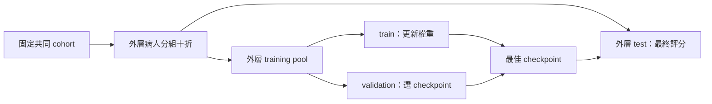

[English](README.md) | [繁體中文](README.zh-TW.md) | [日本語](README.ja.md)

# 單流與多流 OCT 實驗

一套整合資料檢查、訓練、模型選擇、交叉驗證、外部驗證與推論的實驗流程。單流與 2–8 流實驗共用同一套程式，透過設定中的 `data.streams` 指定輸入影像流。

**原始版本完整保留於本機專案封存目錄 `../old/`。** 新版框架修正了舊版的評估設計，因此評分定義有所不同，不宜直接與歷史分數比較。文中的 `../old/` 與 `archive_manifest.json` 均指本機封存內容，不包含在發布的程式碼或模型儲存庫中。

## 1. 專案結構

```text
multistream_project/
├── old/                         # 原有程式、模型、圖片、records、wandb、稽核
├── new/
│   ├── main.py                  # 訓練／驗證與本機 checkpoint 推論入口
│   ├── configs/                 # 共用設定與單流／多流範例
│   ├── multistream/
│   │   ├── config.py            # 設定繼承、路徑與參數檢查
│   │   ├── data.py              # 資料掃描、manifest、同步影像前處理
│   │   ├── splits.py            # 固定病人分組，外層 test／內層 validation
│   │   ├── models.py            # 通用單流／特徵融合模型及 strict checkpoint
│   │   ├── metrics.py           # Accuracy、F1、各類 recall、AUROC、混淆矩陣
│   │   ├── engine.py            # 訓練、選模、測試、逐例預測輸出
│   │   ├── gradcam.py           # ResNet 的各 stream Grad-CAM
│   │   └── cli.py               # 將上列模組連成命令流程
│   ├── tools/
│   │   ├── create_demo_data.py  # 產生合成圖片，確認程式流程
│   │   ├── run_experiments.py   # 在相同 split 上比較 16 組條件
│   │   ├── infer_published.py   # 選擇 Hugging Face condition／fold 推論
│   │   ├── export_model_collection.py # 匯出全部 stream／fold 模型
│   │   └── upload_model_collection.py # 核對並逐模型上傳／續傳
│   ├── tests/                   # 資料隔離、載入、指標及完整流程測試
│   ├── artifacts/              # prepare 後產生 manifest.json / splits.json
│   └── runs/                   # 每組實驗獨立目錄，不覆蓋舊紀錄
├── archive_manifest.json
└── README.md
```

### 舊版與新版的差異

| 項目 | 舊版 | 新版 |
|---|---|---|
| 程式入口 | 依影像流數量複製多個訓練檔案 | 單一入口與通用模型 |
| 切分單位 | 病例資料夾隨機分折 | 以 `patient_id` 分組 |
| 驗證與測試 | 在同一折選擇模型並報告峰值 | 以內層驗證集選模，最後在外層測試集評分 |
| 資料切分保存 | 同一 JSON 可能被覆寫 | 固定 manifest／splits，並以指紋核對 |
| 前處理 | 訓練、驗證與推論的裁切參數不同 | 檢查點保存設定，驗證與推論共用相同設定 |
| 輸入順序 | 依字典與外部模板排列 | 檢查點明確保存影像流的順序 |
| 模型載入 | 推論使用 `strict=False` | 嚴格載入，拒絕缺少或額外的參數 |
| 結果 | 準確率／損失，推論僅保存預測類別 | 保存各類機率、分類指標與逐例 CSV |

## 2. 環境

建議使用 **Python 3.11**；程式需要 Python 3.10 以上與 PyTorch 2.6 以上。框架初次整理時已在 `new/.venv/` 建立獨立的 CPU 測試環境，與原有的 PyTorch 環境分開。

若本機已具備該環境，可在 Windows 的 `new/` 目錄執行：

```powershell
.\.venv\Scripts\python.exe main.py --help
.\.venv\Scripts\python.exe -m pytest tests -q
```

若搬到其他電腦，重新建立環境，不要複製 `.venv/`：

```bash
# 確認此處 python 是 Python 3.11，再建立環境
python -m venv .venv
# Windows: .venv\Scripts\activate
# Linux/macOS: source .venv/bin/activate
python -m pip install -r requirements-dev.txt
```

進行 GPU 訓練時，請先依 [PyTorch 官方安裝頁](https://pytorch.org/get-started/locally/) 安裝與 CUDA 相容的 torch／torchvision，再安裝專案相依套件。CPU 測試環境本身不支援 CUDA；`device: auto` 會依目前環境選擇 CPU 或 GPU。

第一次使用 `model.pretrained: true` 會下載 ImageNet 權重；離線測試使用 `pretrained: false`。

## 3. 先跑一個合成資料範例

以下是在 `new/` 執行的完整流程。合成資料只是測試程式能否運作，**不代表眼科模型效能**。

```powershell
.\.venv\Scripts\python.exe tools/create_demo_data.py --output smoke_output/dataset
.\.venv\Scripts\python.exe main.py prepare --config configs/smoke.yaml
.\.venv\Scripts\python.exe main.py train --config configs/smoke.yaml
.\.venv\Scripts\python.exe main.py train --config configs/smoke_fusion.yaml
.\.venv\Scripts\python.exe main.py validate --checkpoint smoke_output/single_run/fold_0/best_model.pth --manifest smoke_output/manifest.json --splits smoke_output/splits.json --subset test --output smoke_output/validation_demo
.\.venv\Scripts\python.exe main.py infer --checkpoint smoke_output/fusion_run/fold_0/best_model.pth --root smoke_output/dataset --output smoke_output/inference_demo --gradcam --max-cams 2
```

程式會保留既有輸出並拒絕覆蓋。框架初次驗證時執行的範例輸出保存在本機的 `smoke_output/`；再次執行時，請改用新路徑，或複製 smoke 設定並修改 root、manifest、splits、output_dir。

## 4. 真實資料格式與病人 ID

```text
dataset/
├── bad/
│   └── PATIENT001_EXAM001_OD/
│       ├── PATIENT001_EXAM001_OD_vertical.jpg
│       ├── PATIENT001_EXAM001_OD_horizontal.jpg
│       ├── PATIENT001_EXAM001_OD_color_full.jpg
│       ├── PATIENT001_EXAM001_OD_color_inner.jpg
│       ├── PATIENT001_EXAM001_OD_color_outer.jpg
│       ├── PATIENT001_EXAM001_OD_gray_full.jpg
│       ├── PATIENT001_EXAM001_OD_gray_inner.jpg
│       └── PATIENT001_EXAM001_OD_gray_outer.jpg
└── good/
    └── PATIENT002_EXAM001_OS/
        └── ...
```

預設類別對應為 `bad=0`、`good=1`，會隨模型一起保存，推論時不會重新推定類別索引。支援的影像格式為 jpg/jpeg/png/bmp/tif/tiff/webp。

掃描器採用固定排序，並拒絕同一病例名稱出現在不同標籤下、同一影像流有多張候選影像，以及重複使用同一完整影像路徑。`require_all_streams: true` 時，缺少必要影像流也會報錯；設為 `false` 則略過不完整病例，並記錄於 `scan_report`。推論時一律要求模型所需的影像流完整。

**重要：掃描器把資料夾名稱第一個 `_` 之前的字串當作 `patient_id`。** 例如 `PATIENT001_EXAM001_OD` 的病人鍵是 `PATIENT001`。請先確認這符合實際資料的病人身分；程式無法單靠檔名核實身分。同病人雙眼與不同檢查必須使用相同 patient_id。

正式病人索引可自行提供 manifest，不必受檔名規則限制：

```json
{
  "version": 1,
  "class_to_idx": {"bad": 0, "good": 1},
  "streams": ["gray_inner"],
  "samples": [
    {
      "sample_id": "EXAM001_OD",
      "patient_id": "VERIFIED_PATIENT001",
      "label": 0,
      "images": {"gray_inner": "../images/EXAM001_OD_gray_inner.jpg"}
    }
  ]
}
```

這只是單一病例的格式示意；實際分折需足夠病人與每個類別。JSON 中的相對影像路徑以 manifest 所在目錄為基準。手工 manifest 可以省略 `fingerprint`，載入時重新計算；已有 fingerprint 若與內容不同會拒絕。編輯 patient_id／label 後，請另存新 manifest 並移除舊 fingerprint，再重新 prepare。

每例的 images 必須與 manifest.streams 所列的影像流完全一致。若要公平比較八種單流與融合模型，manifest 應包含全部八種影像流；訓練時只取設定指定的子集。

指紋涵蓋中繼資料、label、patient_id、streams 與正規化後的影像路徑，**不包含影像位元組內容**。影像內容應保持不變；目前無法透過指紋偵測同一路徑下被覆寫的圖片。

## 5. 設定與準備資料

先修改 `configs/base.yaml` 的 `data.root`。目前範例路徑沿用舊專案資料來源，原始資料沒有附在這個工作區，需要指向實際存在的位置。

**YAML 內的相對路徑，以該設定檔所在目錄為基準；命令列覆寫的相對路徑，以執行命令的目前目錄為基準。** `extends: base.yaml` 可繼承共用設定，已繼承的路徑仍以定義它的檔案為基準。

```bash
python main.py prepare --config configs/base.yaml
# 或從正式病人 manifest 建立新的共享資料與切分
python main.py prepare --config configs/base.yaml --from-manifest verified_manifest.json
```

prepare 預設要求共同 cohort 具備全部八種影像，產生：

- `artifacts/manifest.json`：病例、病人、label、各 stream 的路徑與指紋。
- `artifacts/splits.json`：固定 train / validation / test 的 sample IDs 與指紋。

外層採用 10 折 `StratifiedGroupKFold`，同一病人的所有病例均分配至同一外層折。每個外層訓練資料池再保留約 20% 的病人作為內層驗證集；以固定隨機種子產生多組病人群組保留切分，選擇最接近目標大小與類別比例的方案。訓練、驗證與測試三個資料分區都必須包含各類別；病人數不足時會報錯。



相同 manifest / splits 用於全部模型。不要為每種 stream 重新 prepare；這會讓模型比較的資料條件不同。

## 6. 訓練

```bash
python main.py train --config configs/single_gray_inner.yaml
python main.py train --config configs/fusion_2_color.yaml
python main.py train --config configs/fusion_3_color.yaml
python main.py train --config configs/fusion_4.yaml
python main.py train --config configs/fusion_6.yaml
python main.py train --config configs/fusion_8.yaml
```

先只跑一折確認記憶體與設定：

```bash
python main.py train --config configs/fusion_8.yaml --folds 0
# 同一設定與 output 之後補上尚未建立的 folds
python main.py train --config configs/fusion_8.yaml --folds 1 2 3 4 5 6 7 8 9
```

已存在的折數目錄不能覆蓋；部分折完成後，可再執行其餘折。**目前不支援從訓練中途的 epoch 恢復。** 若某折中途失敗，請保留該次紀錄，並使用新的 output_dir 重新執行。

### 模型與前處理

單流模型採用 timm 影像分類器。多流模型為各影像流配置獨立的骨幹網路，將各流經全域池化後的特徵串接，再送入兩層多層感知器（MLP）與分類器，完成特徵層融合。

預設採用 ResNet50，以 ImageNet 權重初始化，並微調全部骨幹網路。若 `freeze_backbones: true`，骨幹網路權重與 BatchNorm 統計量會固定，融合 MLP 與分類器仍持續訓練。

前處理的預設輸入大小為 448×448。訓練時，各影像流的隨機裁切與水平翻轉共用相同幾何參數；驗證、測試與推論共用 RGB 轉換、Resize、CenterCrop、Normalize。設定必須符合 `image_size <= resize_size`，錯誤組合會在訓練前報錯。請依影像特性與眼別研究設計，判斷水平翻轉是否合適。

預設採用 AdamW，學習率為 0.0007，訓練 50 epochs，搭配餘弦學習率排程。以最低驗證損失選模，連續 10 epochs 未改善則提前停止；`patience: 0` 可關閉提前停止。`selection_metric` 也可設為 `accuracy`、`balanced_accuracy`、`macro_f1` 或 `auroc`；所有選模指標均只使用內層驗證集，測試集不參與選模。

### 用新版單流權重初始化融合模型

此步為選用；預設直接用 ImageNet 初始化各 backbone，不依賴舊版 checkpoint。

```yaml
model:
  initialization:
    color_inner: ../runs/single_color_inner/fold_{fold}/best_model.pth
    color_outer: ../runs/single_color_outer/fold_{fold}/best_model.pth
```

請先使用共用的 manifest／splits，完成對應的新版單流模型訓練。載入時會核對影像流、架構、折數、manifest、split、三個資料分區的病人 ID、類別對應與前處理；不符合即拒絕。缺少病人切分資訊的舊版權重，不能用來初始化新版交叉驗證實驗。

合成資料另有 `configs/smoke_warmstart.yaml`，可在完成 `configs/smoke.yaml` 後執行，驗證新版單流初始化融合模型的流程。

## 7. 實驗輸出與指標

```text
runs/fusion_8/
├── config.json                  # 完整解析後設定
├── experiment.json              # 設定、資料、split 指紋
├── splits.json                  # 此次使用的固定切分
├── fold_0/
│   ├── best_model.pth            # 權重、stream 順序、標籤、前處理、病人隔離資訊
│   ├── epoch_metrics.csv         # 每個 epoch 的訓練／內層驗證結果
│   ├── validation_metrics.json   # 選模用驗證結果
│   ├── validation_predictions.csv
│   ├── test_metrics.json         # 外層未參與選模的 test 結果
│   ├── test_predictions.csv      # 真值、預測、每類機率
│   └── summary.json
├── fold_1/ ...
├── summary.json                 # 完成 folds、各折結果、OOF 統合指標
├── summary.csv                  # 各 fold 比較表
└── out_of_fold_predictions.csv   # 每病例只收其外層 test 預測
```

應優先報告**測試集／折外預測（out-of-fold, OOF）**指標，而非驗證集峰值。只完成部分折時，OOF 僅涵蓋已完成的折，不能視為完整十折結果。同一病人有多次檢查時，指標仍以病例為單位；病人層級的統合方式，以及以病人為抽樣單位的信賴區間，需另行定義。

輸出包含準確率（accuracy）、平衡準確率（balanced accuracy）、macro F1、各類別的精確率／召回率／F1、one-vs-rest AUROC、macro AUROC 與混淆矩陣。混淆矩陣的列為真實類別、欄為預測類別，類別順序會明確保存。類別不足時，AUROC 為 `null`，不以 0 代替。`summary.json` 另記錄各折測試指標的平均值與樣本標準差。各折 AUROC 的平均值，與合併不同折模型的 OOF 機率後計算的 AUROC，屬於不同統計量，應分別標示。

在 `bad=0 / good=1` 的設定下，bad 類別召回率表示辨識 bad 病例的能力；good 類別召回率則表示辨識 good 病例的能力。報告敏感度（sensitivity）時，必須指定陽性類別。平衡準確率平均計算真實資料中有樣本的各類別召回率；macro F1 則平均計算所有設定類別的 F1。

本版以本機 JSON／CSV 保存紀錄，不需要 W&B 帳號。舊版 W&B 資料完整保留於本機封存目錄 `../old/wandb/`。

## 8. 驗證與推論

### 重算某折的固定外層測試結果

```bash
python main.py validate --checkpoint runs/fusion_8/fold_0/best_model.pth --manifest artifacts/manifest.json --splits artifacts/splits.json --subset test --output runs/recheck_fold_0
```

如需檢查選模使用的驗證集，可改用 `--subset validation`；輸出會標示其用途為選模驗證，不能視為獨立測試集。

### 在新的有標籤群組驗證

```bash
python main.py validate --checkpoint runs/fusion_8/fold_0/best_model.pth --root /path/to/new_labeled_dataset --output runs/external_fold_0
```

預設會將新群組的病人 ID，與檢查點中的訓練／驗證病人 ID 核對；若有重疊便停止。此檢查依賴可靠的 patient_id，不能取代原始病人索引與影像來源的核對。探索性分析可明確加上 `--allow-patient-overlap`，輸出會註明無法確立獨立性。

### 無標籤影像推論

```text
unlabeled_dataset/
├── PATIENT901_EXAM001_OD/
│   └── ...模型需要的影像...
└── PATIENT902_EXAM001_OS/
    └── ...
```

```bash
python main.py infer --checkpoint runs/fusion_8/fold_0/best_model.pth --root /path/to/unlabeled_dataset --output runs/inference_fold_0
```

`infer` 可處理有標籤或無標籤資料，不會因病人重疊而阻止預測。產生這些預測並不代表完成獨立驗證。有標籤時會另輸出描述性指標，並於 `evaluation_scope.json` 記錄評估用途；無標籤時不計算準確率。

推論只需檢查點與資料來源；架構、影像流順序、類別對應、裁切與正規化設定，均由檢查點讀取。輸出為 `predictions.csv`、`metrics.json`、`evaluation_scope.json`。不同折請使用不同輸出目錄，例如：

```powershell
0..9 | ForEach-Object {
    .\.venv\Scripts\python.exe main.py infer --checkpoint "runs/fusion_8/fold_$_/best_model.pth" --root "D:/my_cohort" --output "runs/inference_fold_$_"
}
```

這是十個模型對同一群組產生的預測，不代表十份獨立測試群組。本版不會將重複預測合併後視為 430 個不同病例，也不會把所有折模型對內部病例的預測都當作 OOF。

### Grad-CAM

```bash
python main.py infer --checkpoint runs/fusion_8/fold_0/best_model.pth --root /path/to/data --output runs/inference_with_cam --gradcam --max-cams 8
```

目前支援具有 `layer4` 的 ResNet。針對模型預測類別，分別計算各影像流最後一個區塊的 Grad-CAM，並疊加於**實際送入模型的中央裁切影像**。`gradcam/index.json` 記錄影像與影像流的對應。此圖呈現模型關注區域，不能視為真實標註或可靠度的證明。

## 9. 保留與轉換舊模型

原始模型保留於本機封存目錄 `../old/records/`。新版不會自動推定其影像流順序、標籤與裁切設定；請先提供與原實驗相符的設定，再進行嚴格轉換：

```bash
python main.py convert-legacy --checkpoint ../old/records/image-classification-7/resnet50_runresnet50_run_gray_inner@0_fold/best_model.pth --config configs/single_gray_inner.yaml --output runs/legacy_gray_inner.pth
python main.py infer --checkpoint runs/legacy_gray_inner.pth --root /path/to/data --output runs/legacy_predictions
```

僅支援原始 timm 單流狀態字典（state dict），以及舊版 b1…bN／merger／fc 特徵融合結構；architecture 與 hidden_dim 必須相符。載入時使用 `weights_only=True`，不會退回不受限制的 pickle 載入方式。轉換後標記為 `legacy_no_split_metadata: true`，可用於預測，但不能作為新版病人分組交叉驗證的初始化權重。若缺少歷史資料切分的來源紀錄，便無法確認外部驗證是否達到病人獨立。

以上範例是在明確指定設定的前提下進行轉換；若歷史裁切設定或影像流順序尚未釐清，請先還原相關設定，再比較模型效能。

## 10. 共用切分比較 16 組條件

```bash
python tools/run_experiments.py --list
# 先比較單流基線與八流模型
python tools/run_experiments.py --config configs/base.yaml --conditions single_gray_inner fusion_8
# 或指定一折測試
python tools/run_experiments.py --config configs/base.yaml --conditions single_gray_inner fusion_8 --folds 0 --output runs/pilot
# 不給 --conditions 會依序執行全部 16 組
```

此工具共用同一組 manifest／splits，依條件修改 streams，分別保存完整實驗與 `comparison.csv`。比較表呈現各條件已完成折的 OOF 測試指標；請確認各條件的 completed_folds／planned_folds 是否一致。掃描與 prepare 僅需執行一次。

## 11. 已驗證範圍與參考

可執行 `python -m pytest tests -q` 重跑測試。測試涵蓋病人隔離、折數覆蓋、標籤矛盾、指紋不符、同步裁切、不同影像流數量的前向傳播、嚴格載入檢查點、權重初始化、與手算結果比對指標、僅使用驗證集選模，以及小型 CPU 訓練／驗證／推論流程。

訓練框架初次交付時，記錄的測試結果為 **58 passed、14 subtests passed**；另已執行兩折單流／雙流訓練、固定測試集重算、有／無標籤推論、Grad-CAM、新版單流權重初始化融合模型、16 條件工具的兩組試跑，以及原有單流權重的嚴格轉換。環境版本見 `requirements-tested.txt`，核對紀錄見 `verification.json`。該版本清單記錄當時的 CPU 測試環境，不是 GPU 環境的安裝指令。

完整流程測試使用合成資料，不能取代真實影像的效能驗證。原始真實影像與部分歷史推論模板未包含於目前工作區，因此尚未在真實群組重跑正式實驗。

- [PyTorch checkpoint 載入](https://docs.pytorch.org/docs/stable/generated/torch.load.html)
- [scikit-learn StratifiedGroupKFold](https://scikit-learn.org/stable/modules/generated/sklearn.model_selection.StratifiedGroupKFold.html)
- [timm feature extraction](https://huggingface.co/docs/timm/en/feature_extraction)
- 原始內部實驗稽核，僅限本機封存目錄：`../old/audit/2026-10-02/internal_experiment_audit.txt`。

## 12. 發布到 GitHub 與 Hugging Face

儲存庫首頁、本使用說明、模型集合及各個模型的預設 README 均以英文呈現，頁首提供繁體中文與日文切換連結。發布工具會重新產生包含三種語言的模型集合與個別模型說明。

在 Windows 雙擊 [publish_erm_ai.bat](publish_erm_ai.bat)：fork `ntuhophai/ERM-AI` 到本機登入的 GitHub 帳號，提交新版程式與文件，開啟由你手動建立 PR 的比較頁。上次發布分支未遭其他修改且 PR 尚未關閉／合併時，會接續更新它，讓現有 PR 一併顯示更新內容。

模型階段會自動處理 **16 組影像流條件 × 10 折 = 160 個模型，加上 7 個歷史權重，共 167 個**，並提交至 Hugging Face 儲存庫 `ntuhophai/ERM-AI` 的同一個 PR，待維護者審查與合併。各條件／折均有獨立目錄、純權重檔、設定與說明，會發布完整模型集合。原始模型約占 43.4 GB，首次匯出需要額外空間；中斷後可核對快取與遠端內容並接續上傳。

首次執行需完成官方登入，並確認本機舊版模型設定檔；密碼／Token 不會寫入腳本。舊模型仍保留於本機 `old/` 封存目錄。歷史設定不完整的 7 個模型會保留張量，並標示為無法自動推論。

- [PUBLISHING.md](PUBLISHING.md)：BAT 操作、PR、權限、公開範圍與續傳。
- [MODEL_CATALOG.md](MODEL_CATALOG.md)：全部模型、固定 stream 順序、架構、標籤與前處理限制。
- [INFERENCE.md](INFERENCE.md)：下載指定模型／fold、全部十折推論、ensemble、機率 CSV 與固定版本。

Hugging Face 模型推論範例（從 `new/` 執行）：

```powershell
.\.venv\Scripts\python.exe tools/infer_published.py --repo ntuhophai/ERM-AI --condition single_gray_inner --fold 0 --root "D:/my_cases" --output "predictions/gray_inner_fold0"
.\.venv\Scripts\python.exe tools/infer_published.py --repo ntuhophai/ERM-AI --condition fusion_8 --all-folds --root "D:/my_cases" --output "predictions/fusion8_all"
```

完整模型集合已發布於預設的 `main` 版本，上述指令可直接使用。如需固定版本，請加上 `--revision <commit-sha>`（見 [INFERENCE.md](INFERENCE.md)）；維護者若要測試尚未合併的新 Hub PR，可使用 `--revision refs/pr/<number>`。僅下載指定模型，影像會留在本機。這批舊版權重不含病人切分中繼資料，其推論成績不能改稱為新版病人分組交叉驗證結果。

**2026-10-12** 更新後記錄的完整測試結果為 **186 passed、33 subtests passed**。全部 160 個正式折模型的權重鍵、形狀與資料型別均符合宣告架構；完整模型包已在本機匯出並通過上傳前檢查，實際遠端傳輸由 BAT 執行。以上為歷史驗證紀錄，並非本次文件翻譯時重新執行的測試。
